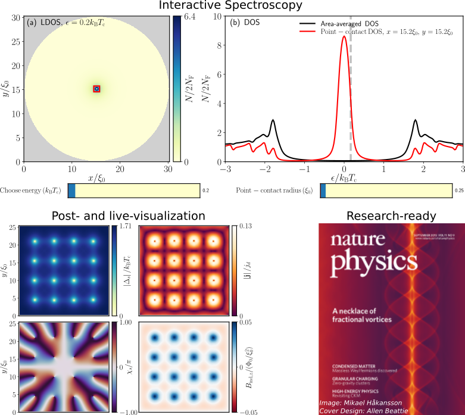

# SuprConGPU

[Niclas Wall-Wennerdal](https://gitlab.com/niclas_wall_wennerdal), [Patric Holmvall](https://gitlab.com/Holmvall), [Oleksii Shevtsov](https://gitlab.com/oshevtsov), [Pascal Stadler](https://gitlab.com/pascalsta), [Mikael Håkansson](https://www.linkedin.com/in/mikael-h%C3%A5kansson-07549a1)

SuprConGPU is an open-source framework for simulating the physics of superconducting and condensed-matter systems, specifically 2D mesoscopic grains in equilibrium, by using the quasiclassical theory of superconductivity. The core is written in C++ and CUDA, exploiting the parallel nature quasiclassics and utilizing the computational power of modern GPUs.

**Backend:** The framework self-consistently solves for the superconducting order-parameter and the magnetic vector potential, and computes the the current density, magnetic induction, free energy, as well as the local density of states. The simulations can be visualized in real-time with OpenGL.

**Frontend:** A user-friendly Python frontend is provided, enabling simulation parameters to be defined via intuitive configuration files, or via command-line interface (CLI), without requiring a deep understanding of implementation details. Furthermore, the framework ships with simple and interactive tools for visualization and data analysis, making SuprConGPU an ideal tool both for research but also for educational purposes. SuprConGPU is available to use under the license agreements stated in LICENSE.txt, and it can be used on all Unix-based platforms.



## Download
The source can be obtained by [cloning](https://docs.gitlab.com/ee/gitlab-basics/start-using-git.html#:~:text=Clone%20a%20repository&text=You%20can%20either%20clone%20it,paste%20in%20your%20command%20line.) the repository through the above interface.


## Installation
For detailed instructions on installation and compilation, see: [https://suprcongpu.gitlab.io/suprcongpu-doc/install.html](https://suprcongpu.gitlab.io/suprcongpu-doc/install.html)


## Documentation
A user manual with tutorials, examples and additional information can be found in the [official documentation](https://suprcongpu.gitlab.io/suprcongpu-doc/). This documentation is built from the [documentation repository](https://gitlab.com/suprcongpu/suprcongpu-doc). API documentation can be found [here](https://suprcongpu.gitlab.io/suprcongpu/).


## Citing SuprConGPU
If you have used SuprConGPU in your research or found it useful, please [cite it](https://suprcongpu.gitlab.io/suprcongpu-doc/cite.html). Please let us know about your research in turn, as we find any application of SuprConGPU of great interest, and want to include your usage of it in our future outreaches.


## Basic usage
The code is most easily run via its Python(3) frontend `suprcongpu.py`. It is highly recommended to use the `--file` argument to specify the location of an existing configuration file which sets all simulation parameters, e.g. the Abrikosov-vortex lattice example:
```shell
python suprcongpu.py --file examples/swave_abrikosov_vortex_lattice/config.json
```
These example files can easily be copied/modified with a text editor, to create new simulations of other systems. To see further usage instructions, use the `-h` or `--help` flag
```shell
python suprcongpu.py --help
```
or refer to the [tutorial](https://suprcongpu.gitlab.io/suprcongpu-doc/tutorials.html) in the online documentation.


## Data post-processing and visualization
Simulation data can be saved to file by running the program with the `--save-data` flag
```shell
python suprcongpu.py --save-data --file examples/swave_abrikosov_vortex_lattice/config.json
```
This saves data in the path specified by the `"data_path"` option in `config.json` (which can also be overriden by the command-line argument `--data-path`). Whatever data path was used, will be printed to the terminal upon successfully finishing the simulation. The data is saved in two formats: real-space observables and quantities are saved in human-readable `.csv`-files (i.e. columns of Comma-Separated Values), while parameters and and other scalar quantities are generally saved in `.json`-files. These formats are supported by most modern programming languages and post-processing/plotting tools. To facilitate post-processing and plotting, an additional Python program is available, called `plotter.py`, which demonstrates how the data can be parsed from file and plotted. To simply plot all the data in e.g. `data/swave_abrikosov_vortex_lattice/T0.200000/`, use the `--data-path` argument:
```shell
python plotter.py --data-path data/swave_abrikosov_vortex_lattice/T0.200000
```
To see further usage instructions, run `python plotter.py --help`, or refer to the [tutorials](https://suprcongpu.gitlab.io/suprcongpu-doc/tutorials.html).


## Contribute
[](code_of_conduct.md)

We encourage any useful contributions to the development of SuprConGPU, by forking this repository and sending merge requests, sharing bug reports or suggestions via the [issues page](https://gitlab.com/suprcongpu/suprcongpu/-/issues), or contacting us with any questions and discussions.

All contributions are acknowledged in the [contributors section](https://suprcongpu.gitlab.io/suprcongpu-doc/contributors.html). For more information, including technical advice, please see [Contributing to SuperConGPU development](https://suprcongpu.gitlab.io/suprcongpu-doc/contribute.html) in the online documentation. Please note that any contribution must adhere to our [code of conduct](https://gitlab.com/suprcongpu/suprcongpu/-/blob/master/CODE_OF_CONDUCT.md).


## License
[](https://www.gnu.org/licenses/lgpl-3.0)

You are free to use this software, with or without modification, provided that the conditions listed in the LICENSE.txt file are satisfied.


## Support
SuprConGPU development is supported by the Applied Quantum Physics Laboratory at the Department of Microtechnology and Nanoscience - MC2, Chalmers University of Technology. We acknowledge the Swedish Research Council (VR) for financial support of the doctoral and post-doctoral projects during which a considerable part of the development has been carried out. Computational resources have been provided by Chalmers Centre for Computational Science and Engineering provided by the Swedish National Infrastructure for Computing.


## Authors
The current lead developers are Niclas Wall-Wennerdal, Patric Holmvall and Pascal Stadler. Previous developers are Mikael Håkansson and Oleksii Shevtsov. The project is supervised by Mikael Fogelström and Tomas Löfwander.
